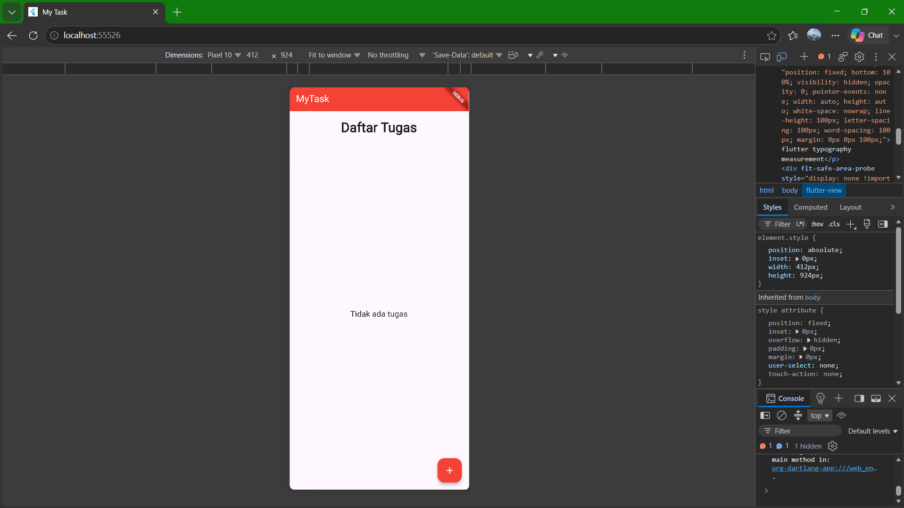

# MyTask

## Identitas
- Nama  : Bagas Aldianata
- NIM   : 103012680043

## Deskripsi
MyTask merupakan aplikasi mobile pencatatan / manajemen tugas sederhana yang dibuat menggunakan Flutter

## Screenshot Aplikasi
- Home Screen


- Input Form


- Home Screen dengan 1 data


## Langkah Singkat Menjalankan Aplikasi
1. Clone repositori ini:

2. Buka folder project menggunakan Visual Studio Code.

3. Install extension Flutter pada Visual Studio Code. Extension Dart biasanya akan ikut terpasang.

4. Install SDK Flutter versi terbaru: https://docs.flutter.dev/install/archive

5. Install dependencies:
   flutter pub get

6. Jalankan aplikasi:
    flutter run

## Deklarasi Penggunaan AI
- Apakah menggunakan AI? **Ya**
- Tool AI yang digunakan: **ChatGPT**
- Estimasi persentase kontribusi AI: **20%**
- Bagian kode/fitur yang dibantu AI: 
  - Membuat Local Storage
    
    Disini melihat tutorial video di youtube dan menggunakan AI dikarenakan kebingungan cara implementasi 

    File keys.dart
    ```class Keys {
        static const String tasks = 'taks';
    }
    ```

    File get_storage.dart
    ```import 'package:get_storage/get_storage.dart';

    class GSService {
    static final box = GetStorage();

    static Future<void> init() async {
        await GetStorage.init();
    }

    static dynamic get(String key) {
        return box.read(key);
    }

    static Future<void> save(String key, dynamic value) async {
        await box.write(key, value);
    }

    static Future<void> remove(String key) async {
        await box.remove(key);
    }
    }
    ```

  - Memperbaiki Syntax Error
    ```
    import 'package:get_storage/get_storage.dart';

    class GSService {
    static final box = GetStorage();

    static Future<void> init() async {
        await GetStorage.init();
    }

    static dynamic get(String key) {
        return box.read(key);
    }

    static Future<void> save(String key, dynamic value) async {
        await box.write(key, value);
    }

    static Future<void> remove(String key) async {
        await box.remove(key);
    }
    }
    ```

Pernyataan:  
"Saya menyatakan bahwa saya memahami alur dan fungsi dari seluruh kode yang ada dalam 
repositori ini"