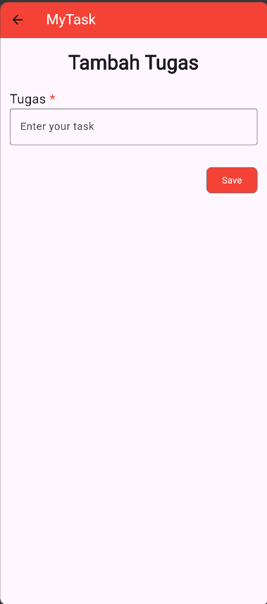
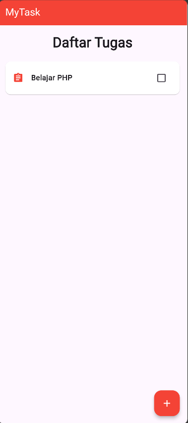

# MyTask

## Identitas
- Nama  : Bagas Aldianata
- NIM   : 103012680043

## Deskripsi
MyTask merupakan aplikasi mobile pencatatan / manajemen tugas sederhana yang dibuat menggunakan Flutter

## Screenshot Aplikasi
- Home Screen


- Input Form


- Home Screen dengan 1 data


## Langkah Singkat Menjalankan Aplikasi
1. Clone repositori ini: https://github.com/Bagas284/flutter_mytask.git

2. Buka folder project menggunakan Visual Studio Code.

3. Install extension Flutter pada Visual Studio Code. Extension Dart biasanya akan ikut terpasang.

4. Install SDK Flutter versi terbaru: https://docs.flutter.dev/install/archive

5. Install dependencies:
   flutter pub get

6. Jalankan aplikasi:
    flutter run

## Deklarasi Penggunaan AI
- Apakah menggunakan AI? **Ya**
- Tool AI yang digunakan: **ChatGPT**
- Estimasi persentase kontribusi AI: **20%**
- Bagian kode/fitur yang dibantu AI: 
  - Membuat Local Storage
    
    Disini melihat tutorial video di youtube dan menggunakan AI dikarenakan kebingungan cara implementasi 

    File keys.dart
    ```class Keys {
        static const String tasks = 'taks';
    }
    ```

    File get_storage.dart
    ```import 'package:get_storage/get_storage.dart';

    class GSService {
    static final box = GetStorage();

    static Future<void> init() async {
        await GetStorage.init();
    }

    static dynamic get(String key) {
        return box.read(key);
    }

    static Future<void> save(String key, dynamic value) async {
        await box.write(key, value);
    }

    static Future<void> remove(String key) async {
        await box.remove(key);
    }
    }
    ```

  - Memperbaiki Syntax Error
    ```
    import 'package:material_ui/material_ui.dart';
    import '../data/TaskData.dart';
    import '../pages/AddPage.dart';
    import '../core/services/get_storage.dart';

    void main() {
    runApp(const MaterialApp(
        home: HomePage(),
        ),
    );
    }

    class HomePage extends StatefulWidget {
    const HomePage({super.key});

    @override
    State<HomePage> createState() => _HomePageState();
    }

    class _HomePageState extends State<HomePage> {
    @override
    void initState() {
        super.initState();

        tasks = List<Map<String, dynamic>>.from(
        GSService.get('tasks') ?? [],
        );
    }

    Future<void> deleteTask(int index) async {
        setState(() {
        tasks.removeAt(index);
        });

        await GSService.save('tasks', tasks);
    }

    @override
    Widget build(BuildContext context) {
        return Scaffold(
        floatingActionButton: FloatingActionButton(
            onPressed:() async {
            final newTask = await Navigator.push<String>(
                context,
                MaterialPageRoute(builder: (context) => AddPage()),
            );

            if (newTask != null && newTask.isNotEmpty) {
                setState(() {
                tasks.add({'title': newTask, 'isCompleted': false});
                });

                GSService.save('tasks', tasks);
            }
            },
            backgroundColor: Colors.red,
            child: const Icon(Icons.add, color: Colors.white),
        ),

        appBar: AppBar(
            title: const Text('MyTask', style: TextStyle(color: Colors.white)), 
            backgroundColor: Colors.red
        ),

        body: Padding(
            padding:  const EdgeInsets.all(16.0),

            child: Column(
            children: [
                const Center(
                child: Text('Daftar Tugas', style: TextStyle(fontSize: 30, fontWeight: FontWeight.bold)),
                ),

                const SizedBox(height: 20),

                Expanded(
                child: 
                    tasks.isEmpty
                    ? const Center(child: Text('Tidak ada tugas', style: TextStyle(fontSize: 18)),)
                    : 
                    ListView.builder(
                        itemCount: tasks.length,
                        itemBuilder: (context, index) {
                        return Card(
                        color: Colors.white,
                        margin: const EdgeInsets.only(bottom: 12),

                        shape: RoundedRectangleBorder(
                            borderRadius: BorderRadius.circular(12),
                        ),

                        child: ListTile(
                            contentPadding: const EdgeInsets.symmetric(
                            horizontal: 16,
                            vertical: 8,
                            ),

                            title: Text(
                            tasks[index]['title'],
                            style: const TextStyle(
                                fontSize: 16,
                                fontWeight: FontWeight.w600,
                            ),
                            ),

                            trailing: Checkbox(
                            value: tasks[index]['isCompleted'],
                            onChanged: (value) {
                                if (value == true){
                                deleteTask(index);
                                }
                            },
                            ),
                        ),
                    );
                    },
                ),
                ),
            ],
            ),
        )
        );
    }
    }
    ```

- Pernyataan:  
"Saya menyatakan bahwa saya memahami alur dan fungsi dari seluruh kode yang ada dalam 
repositori ini"